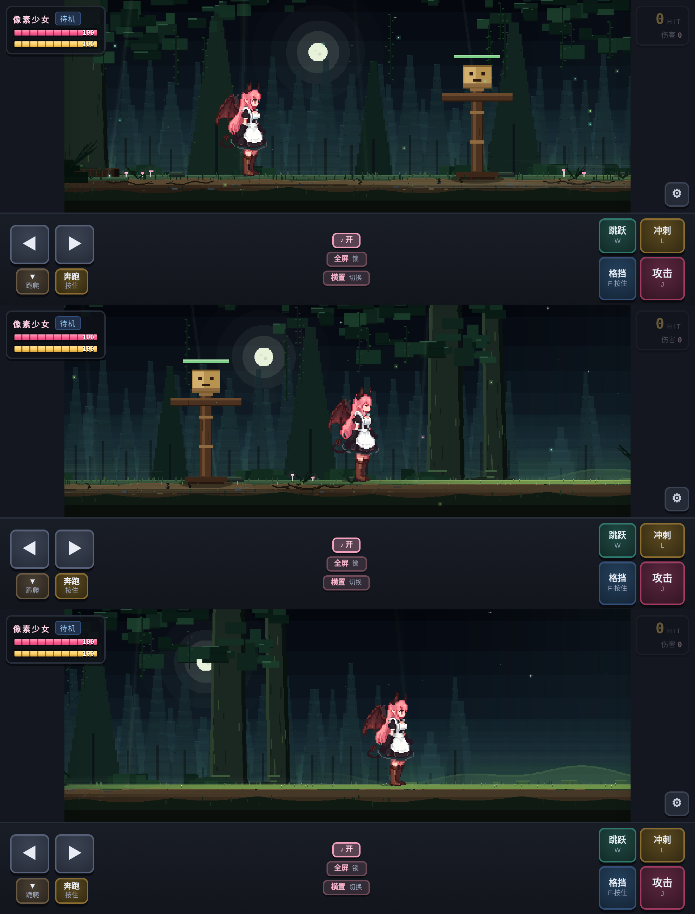

# 像素少女 · 横版动作测试（Pixel Maid Action）

单文件 H5 像素风横版动作原型：原生 Canvas + 内联 CSS/JS，零依赖、零构建，打开即玩。

**在线试玩**：<https://4mjvvkq325ct5.doubao.link/app/app_17jmg19qedf> ｜ GitHub Pages：<https://xiaolian7653.github.io/pixel-maid-action/>



## 特性

- **八组动作状态机**：待机 / 行走 / 奔跑 / 跳跃 / 冲刺 / 四段攻击 / 受击 / 倒地，干净画风关键帧 + 程序化铺帧，逐帧硬切播放。
- **三套格挡**：长按持守 / 拍挡（轻攻击限定）/ 精准弹反（全类型、回架势），架势耗尽触发崩防；木桩自带出招 AI（头顶粉条收缩预警）供判定练习。
- **四段攻击节奏**：蓄力 → 出手 → 延伸 → 随势，出手帧前冲步 + 残影，刀光窗口与判定帧对齐。
- **全宽世界**：1920px 两屏世界，五层程序化视差背景（天空 / 远林 / 中景 / 地面 / 前景），不平铺、无重复；背景与实体两套坐标拆分，边界无黑边。
- **群系渐变**：从丛林走到平原，植被 / 地面 / 天空按世界位置 smoothstep 逐列混合，无硬边分界。
- **像素光影**：多层月晕 + 月光下泄、双层体积光柱（风摆 / 脉冲 / 落地光斑）、地面雾、萤火光晕、四角压暗；全程最近邻硬边，不做非整数缩放。
- **主机式 UI**：左上角色牌（分段像素血条 / 架势条）、右上连击牌，底部方向键 + 街机四键，系统 / 测试键收进侧抽屉；手机端自动横屏适配。

## 操作

| 动作 | 键盘 | 触屏 |
| --- | --- | --- |
| 移动 | ← / → | 左下 ◀ ▶ |
| 奔跑 | Shift（按住） | 「奔跑」按住 |
| 跪爬 | ↓（按住） | 「跪爬」按住 |
| 跳跃 | W / Space | 跳跃（青） |
| 冲刺 | L | 冲刺（金） |
| 格挡 | F（按住；点按为拍挡 / 弹反） | 格挡（冰蓝） |
| 攻击 | J（连按出四段） | 攻击（粉） |
| 复活 | R | 抽屉内「复活」 |

帧速滑块、新帧预览、遥测开关等在右下 ⚙ 抽屉内。

## 仓库结构

```
├── index.html            # 游戏本体（单文件自包含，可直接部署 GitHub Pages）
├── docs/
│   ├── development.md    # 完整开发复盘：动作帧管线、横屏适配、格挡/攻击/场景/光影各轮迭代与自测
│   └── block-config.json # 格挡判定配置 v1.1（tick=1/60s，优先级 perfect>light>hold）
├── screenshots/          # 各里程碑实测截图
├── tools/                # 精灵帧精修流水线（去底洞回填 / 接触行基线 / 调色）
└── assets/sprites/       # 28 个精修动作帧 + 4 个格挡帧 + manifest（页面实际走 CDN 加载）
```

## 技术要点

- **像素保真**：`image-rendering: pixelated` + `imageSmoothingEnabled=false` 每帧重述；相机只做整数平移。
- **程序化背景**：每层独立种子随机（LCG），build 期按全宽烘焙，运行时零生成开销；群系混合也在 build 期完成。
- **判定与表现分离**：格挡窗口按 tick 计（拍挡 0–14 / 弹反 0–12），攻击 reach / 伤害 / 前冲量独立配置。
- **自测方法**：headless Chromium + hook 注入（`window.__P/__D/__C`），三位置截图 + 像素采样 + 动作回归，零 console 报错门禁；详见 `docs/development.md`。

## 本地运行

直接用浏览器打开 `index.html` 即可（精灵图走 CDN，需联网）。部署 GitHub Pages：Settings → Pages → Deploy from branch → `main` / root。

## 说明

- 精灵帧与角色设定为 AI 辅助生成的原创素材；代码与素材仅供学习交流。
- 开发过程、踩坑与已验证死路完整记录在 [docs/development.md](docs/development.md)。